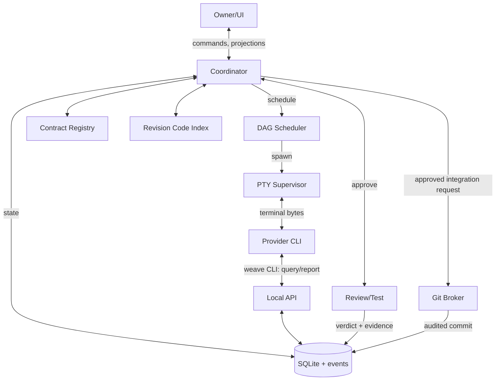

# WEAVE — Technical Architecture

**ID:** WEAVE-ARCH-001 · v1.0 · proposed 2026-10-13  
**Scope:** Local-first Windows MVP with portable Linux/macOS boundaries.  
**Canonical references:** PRD, PROTOCOLS, DATA_MODEL, PROVIDER_RUNTIME, MEMORY_ENGINE, GIT_SECURITY.

## 1. Architectural invariants
1. **Daemon owns actual OS PTYs**; UI only renders session data. A GUI window may restart independently of the daemon.
2. **One authoritative write path** for workflow/tasks/events/memory through daemon domain services and SQLite. CLI/MCP/UI cannot write their own parallel DBs.
3. **Evidence is separate from agent assertion.** Machine event/state changes require schema checks, version/authorization checks and independent verification.
4. **Provider-native CLIs are not modified.** Adapters establish CWD/env/context and use supported CLI capabilities; unsupported flags are not guessed.
5. **Each coding task owns a separate worktree**; shared mutable resources have explicit leases.
6. **Git broker is the sole approved actor** for repository metadata mutation and integration; OS enforcement requires a separate security milestone.
7. **Mastermind documents remain portable**; existing repos with docs/memory and Memex can be imported.
8. **Security boundaries are observable**: every task records `git_isolation_mode: cooperative|enforced`; no universal promise of a filesystem sandbox.

## 2. Process topology
```
┌─────────────────────────────────────────────────────────────────────────┐
│ WEAVE desktop (Tauri / WebView + React)                                 │
│ Project switcher │ phase gates │ DAG │ xterm.js tabs │ diff │ evidence │
└──────────────────────┬──────────────────────────────────────────────────┘
                       │ authenticated local IPC; commands + event cursor
┌──────────────────────▼──────────────────────────────────────────────────┐
│ weave-daemon (separate OS process; persists after window closes)       │
│ Local API / Event Stream                                                │
│ Coordinator ── Workflow/Gates ── Task DAG / leases ── Policy engine      │
│    │               │                    │                               │
│ Memory / Search  Contract Manager    Provider Supervisor                │
│    │               │                    ├── ConPTY session: Claude CLI   │
│    │               │                    ├── ConPTY session: Codex CLI    │
│    │               │                    └── ConPTY session: Gemini CLI   │
│ Code Indexer    Review/Test Broker    Git Broker                       │
│    └──────────────────────┬───────────────┘                              │
│                        SQLite WAL + append-only event table             │
└─────────────────────────────────────────────────────────────────────────┘
           ▲                   ▲                       ▲
           │ CLI socket client │ MCP bridge            │ Git executable
           └──────────────┬────┘                       └────────┬────────
                     worker PTYs                          isolated worktrees
```

**Daemon placement**: Tauri launches/locates a companion executable. Daemon lifetime is not a Tauri webview child tied to the window. On Windows use a per-user single-instance mutex/lock and a **user ACL-protected named pipe** (Unix: chmod 0600 Unix socket). Authentication secret remains outside project worktrees; permissions/security validation is required before a project claims it is protected from same-user hostile processes. A simple local TCP listener is NOT the default.

## 3. Module boundaries
| Module | Owns | Must not own |
|---|---|---|
| `desktop` | View state, terminal rendering, user interactions | Process lifecycle, task verdicts, DB writes |
| `api` | Authenticated local RPC, event stream, version negotiation, request validation | Business rules |
| `workflow` | Phase states, gates, artifacts, checkpoints | Provider-specific flags |
| `scheduler` | DAG, readiness, exclusivity leases, slot allocation, retries | Running `git` directly |
| `supervisor` | Real PTY spawn/I/O/resize/termination, output ring, process registry | Reading ANSI for task acceptance |
| `providers` | Executable probing, role/context installation, capability-specific startup/resume | Authority to create task or approve gate |
| `store` | SQLite schema, transactions, FTS, migration, event outbox | Independent business logic |
| `memory` | Ingestion, retrieval, validation, provenance, project truth projection | Confidently auto-promoting unsupported agent statements |
| `contracts` | Registry/version/validation/generated binding provenance | Inventing API routes |
| `code-index` | Git revision-scoped symbol/reference/search index | Treating indexed code as approved PRD truth |
| `verification` | Reviewer/tester launch, evidence, verdict validation | Reviewer self-approval of own patch |
| `git-broker` | Branch/worktree/commit/merge/push, staged integration, audit | Model-generated direct destructive commands |
| `weave-cli` | Provider-neutral read/report/memory commands | Direct sqlite updates or Git mutations |

## 4. IPC / commands / events
Transport: private local stream connection with length-prefixed JSON frames (UTF-8); messages validated against protocol version. Prefer newline-delimited JSON only if escaped framing is handled and message maximum enforced. PTY output bytes travel as base64 payload of ≤32 KiB chunks. Separate commands from append-only event delivery:
- `request`: `{jsonrpc:"2.0",id,method,params,meta:{api_version,request_id,idempotency_key?,expected_version?}}`
- `response`: `{jsonrpc:"2.0",id,result|error}`
- `event`: `{event_id,seq,kind,project_id,run_id?,task_id?,session_id?,ts,payload}`
- Reconnect handshake includes `{client_id,last_seq}`; daemon replays events with `seq > last_seq`, then live events. Duplicate events may be delivered; UI de-duplicates on seq.
- Terminal stream buffering must not block PTY read; bounded queue drop policy writes `terminal.output_gap` and snapshot pointer; never silently drop task state events.
- Every mutation is idempotent on `(client_id,idempotency_key,method)` during a bounded retention period; compare-and-swap `expected_version` prevents races.

### Minimal RPC methods (frozen names for M0/M1)
```
health.get, system.capabilities,
project.create, project.list, project.open,
run.create, run.status, run.pause, run.resume,
workflow.get, workflow.gate.approve, workflow.gate.request_changes,
task.list, task.get, task.create, task.report, task.cancel,
session.spawn, session.list, session.attach, session.input, session.resize, session.stop,
memory.query, memory.propose, memory.promote, memory.reject,
handoff.create, handoff.accept,
contract.get, contract.validate,
review.submit, test.submit,
git.integrate, git.preview, git.finish
```
Write endpoints enforce role/policy/expected version. UI does not call hidden Python scripts for task transitions.

## 5. Task lifecycle / state machine
```
proposed -> ready -> assigned -> running -> handoff_submitted
                                 |             |          |
                              blocked       failed     reviewing
                                                       | PASS
                                                       v
                                                     testing
                                                       | PASS
                                                       v
                                               integration_ready
                                                       |
                                                       v
                                                   integrated -> done
```
Transitions to `blocked`, `failed`, `cancelled`, `retrying` allowed only through declared policy and events. `ready` requires approved owning phase, passed dependencies, free file/resource leases and acceptable budget. `running` requires recorded live session and worktree ID; process exit alone does not mean handoff. `done` requires integrated commit + tests (or explicit documentation-only completion policy).

- **Transactional transition:** check current status/version, authorization, deps, required evidence, then insert `task_event` and state update in same SQLite transaction.
- **Retry:** max 3 review-fix cycles by default; 4th needs root-cause diagnostic/replan. Spawn a fresh/continued task session as policy allows.
- **Crash:** any `running` task whose session is no longer alive is `interrupted`; reconcile it, do not auto-commit unfinished edits.

## 6. Scheduling and file collisions
- Tasks declare **read/write globs**, resources (e.g. `schema:migrations`, `manifest:package.json`, `contract:AUTH`), phase, dependencies and cost hints.
- `ready` iff every dependency has required success state; task contract pins are approved.
- Conflict if task write paths intersect another task's write paths or exclusive resource leases; conservative glob overlap check that errs toward serialization.
- Worktree lease creation is mediated by broker. Read-only actors can share a snapshot; writers cannot share a worktree.
- Default max 2 writers, 1 reviewer, 1 tester; adaptive concurrency is a P1 experiment, not a hardcoded promise of speedup.
- User paused run suppresses **new** dispatches; running tasks require separate explicit stop/pause policies.

## 7. Persistent storage and recovery
Use SQLite in OS user app-data, project keyed by canonical absolute path + repo identity. Enable foreign keys, WAL, `busy_timeout`, `synchronous=NORMAL` unless tests show unacceptable durability; explicit backups/checkpoints. Migrations have checksums, applied version table, backup-before-import strategy. Application queries go through daemon only. See `DATA_MODEL.md`.

Daemon startup:
1. Acquire single-instance lock; check endpoint and application state.
2. Open DB, run verified migrations, detect Memex import option, load projects/runs/phase/task states.
3. Reconcile process registry; on daemon reboot pre-existing child PTY ownership is not recoverable by default: mark session `interrupted`, record event, retain evidence and checkpoint.
4. Re-index pending code paths, release stale leases safely after auditing active processes.
5. Serve IPC then replay subscriptions; UI reconnects from last event cursor.

## 8. Terminal architecture
- Actual shell/PTy library (`portable-pty` candidate) owns master/child; Windows ConPTY for Windows.
- Each session has `session_id`, `provider`, `cwd`, `env_allowlist`, `command`, `capabilities`, `pid`, `start/end`, `exit_code`, `size`, bounded ring, redacted durable chunks (opt-in), process status.
- Input authorized by session ownership and interactive control policy (shared spectator vs controller). Resize only if attached terminal has ownership token.
- UTF-8/VT control bytes preserve full terminal rendering; do not strip ANSI for xterm.js. Log redaction is done on a separate projection; redacting ANSI stream before rendering may corrupt it.
- Completion signals `weave task report`, independent evidence and validation; never scrape provider TUI for hidden "tool complete" messages.

## 9. Provider / memory / contract / Git isolation
See `PROVIDER_RUNTIME.md`, `MEMORY_ENGINE.md`, `GIT_SECURITY.md`, `PROTOCOLS.md`. These files are normative rather than repeated here. Provider CLI shell execution may bypass prompt-based policies; document trust mode and do not overstate sandbox.

## 10. Failure design
| Failure | Expected behavior |
|---|---|
| Provider missing | capability `unavailable`; error shown; task remains ready/blocked |
| Provider auth required | PTY remains interactive; UI requests user action, no hidden auto-login |
| CLI exits without report | `interrupted` or `failed`; no task acceptance |
| Reviewer detects defect | fix loop task assigned with precise findings; no Git integration |
| IPC disconnect | reconnect cursor; persisted events replay |
| SQLite busy | bounded retry/backoff, transaction-safe, no state loss |
| Invalid JSON/schema | reject with machine error; retain raw artifact for debugging if safe |
| Contract changed mid-task | invalidate pinned dependency; pause affected integrations and request replan |
| Merge conflict | Git broker aborts/stages rollback, task `blocked` with conflict artifact |
| Sandbox unavailable | `cooperative` flag displayed, no security enforcement claim |

## 11. Diagram: authority and information flow


## 12. Versioning
`api_version=1`, DB migrations monotonic integer, schema `schema_version=1`, Mastermind workflow `workflow_version=1`. Unknown major API versions fail with `INCOMPATIBLE_PROTOCOL` and a clear upgrade instruction; do not silently accept incompatible events. Compatible minor field additions must default safely.
