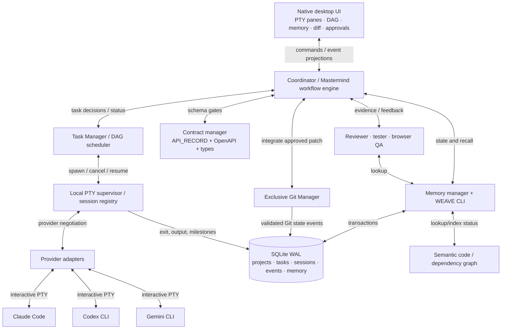

# WEAVE × Mastermind — Native Multi-CLI Orchestrator Blueprint

**Status:** Proposed architecture, not an implemented application  
**Date:** 2026-10-13  
**Foundation:** https://github.com/AditRaj-dev/masterminmd  
**Operating principle:** Reuse Mastermind as the workflow protocol. Build WEAVE as the native, provider-neutral execution engine.

## 1. Problem

Mastermind already defines a strong document-first product development workflow, but its execution is coupled to Claude Code's native Agent dispatch, a per-phase handoff requiring a user-created new session, and mostly narrative coordination. WEAVE must execute the same workflow through concurrently running **interactive terminal CLIs (real PTYs)**, with reliable memory, contracts, reviews, testing, and a single Git authority.

## 2. Assumptions to remove

1. **A shared chat history is not shared memory.** Transfer selected, sourced facts and artifacts, not every token between sessions.
2. **An `AGENTS.md` instruction is not a security boundary.** A worker with filesystem/shell access can still run `git`, overwrite a file, or view secrets unless actual process permissions and controls intervene.
3. **Spawning more agents is not automatically faster.** Dependencies, shared files, context overhead, rate limits, and review costs determine useful concurrency.
4. **An API_RECORD.md is not a machine-enforced API contract.** Keep the verified registry, but generate typed clients and use compatibility checks for internal endpoints.
5. **A terminal view is not the task completion source of truth.** Rely on structured handoffs, process state, file/diff verification, and reviewer/tester verdicts—not just looking for `Done` in terminal text.
6. **All CLI providers cannot take an identical system prompt.** Implement per-provider adapters and capability negotiation; avoid replacing vendor core safety and tool prompts.
7. **An app window is not a durable agent runtime.** A service/daemon must own PTYs if UI close/reopen without losing live sessions is required.

## 3. First principles and split of responsibilities

| Layer | Responsibility | Source of truth |
|---|---|---|
| Mastermind Workflow | Gates, documentation, acceptance conditions, reviewer rules, phase transitions | Versioned `workflow/mastermind.yaml` + authored docs |
| WEAVE Coordinator | Runs workflow state machine, assigns work, approves dispatches, enforces DAG | SQLite tasks / workflow events |
| Task Scheduler | Dependency DAG, risk/overlap detection, agent slots, priority, retries | SQLite task graph |
| Agent Runtime | Owns PTY sessions, resize/kill, input/output stream, cwd/env | PTY process registry and session event log |
| Provider Adapters | Claude/Codex/Gemini capability negotiation, prompt installation, resume | Versioned adapters |
| Memory Manager | Selective recall, validated decisions, handoffs, relevance, provenance | SQLite + authored project documents |
| Code Knowledge | Symbol graph, imports/call edges, optional embeddings | Indexed repo state by commit/worktree |
| Contract Manager | API registry plus versioned internal API and event schemas | OpenAPI/JSON Schema/typed client |
| Git Manager | The only actor authorized to stage, commit, merge, push, delete worktrees | Git repo + auditable transaction log |
| Review/Test/Browser | Independent verification and artifacts | Review/test evidence linked to task |
| Native UI | Interactive terminals, task DAG, gate controls, memory graph, diff review | Read-only projections of core events |

**Authority rule:** The Coordinator decides *what is allowed next*. The Git Manager performs Git mutations. Worker agents implement only their assigned scopes. Human approval overrides important gates and destructive operations.

## 4. Preserve Mastermind's workflow

The existing `mastermind/SKILL.md` phases remain the baseline:

0. **Setup** — initialize docs, branch, graph, project registration.
1. **Discovery** — detailed requirements, edge cases, constraints.
2. **PRD** — goals, personas, flows, acceptance tests.
3. **Feature specs** — buildable feature-level documents.
4. **Implementation plan** — small tasks and parallel groups.
5. **API record** — verified external SDK/API records and planned internal interfaces.
6. **Design** — shared design tokens and system.
7. **Mockups** — high-fidelity HTML/CSS, design review, user approval.
7.5. **HTML-to-React conversion** — where relevant to React/Next, based on approved mockups.
8. **Build** — parallel implementation, diff review, fixes, commits, integration audit.
9. **Wrap** — tests, evidence, acceptance audit, branch finish choices.

**Changes:** Keep approval gates, but do not require the user to manually paste a RESUME.md into a fresh CLI at every phase. At each boundary WEAVE checkpoints state and starts a **new PTY session** itself, passing only the minimum resolved context and the relevant documents. The UI shows `Approve`, `Request changes`, `Pause`, and `Open terminal` actions. Preserve the explicit user approval policy by default.

**Separate phase approval from task progress.** Tasks within an approved phase may advance automatically inside policy; crossing into the next gated phase waits for approval.

## 5. Execution architecture



### PTY first, not headless

- Windows: use real **ConPTY**; macOS/Linux: POSIX PTY.
- Recommended lightweight implementation: **Tauri 2 + Rust runtime + xterm.js renderer**. Evaluate the PTY implementation under Windows first (for example `portable-pty` or another proven cross-platform Rust PTY library); do not assume the normal Tauri shell plugin gives a true interactive terminal.
- A **single local supervisor process** owns child PTYs, output buffers, exit codes, and resize events. The webview merely renders data; it must not own process lifetimes.
- Do not parse task completion solely from ANSI terminal output. Terminal bytes are for display; events from the WEAVE CLI and checks are for decisions.
- Store bounded output chunks and snapshots; no unbounded terminal scrollback in memory.
- On app UI restart, reconnect to the still-running supervisor. If the supervisor itself dies, the PTY cannot generally be reattached; offer provider-supported conversation resume from saved session IDs plus WEAVE checkpoint artifacts.

### Provider adapters / system prompt delivery

Generate a small **role packet** at dispatch:

```yaml
session_id: run-20261013-42
project_id: demo-app
task_id: BE-014
role: backend
provider: codex
model: configured-by-user
worktree: .weave/worktrees/BE-014
memory_scope: [project, backend, task]
contracts: [docs/API_RECORD.md, contracts/http/openapi.yaml]
allowed_paths: [src/server/users/**, tests/server/users/**]
blocked_paths: [src/client/**, .env*]
commands: ["weave memory search", "weave code find", "weave task report"]
verification: ["npm run typecheck", "npm test -- users"]
depends_on: [DB-006]
```

This packet is serialized to a per-session directory, not pasted as a giant repeated prompt. Provider adapters install:

- **Claude Code:** generated `CLAUDE.md` scoped appropriately, role definition where supported; interactive `claude` with `--append-system-prompt-file` when verified by that installed CLI version.
- **Codex CLI:** generated `AGENTS.md` (appropriate working directory scope) plus a concise interactive startup task. Do **not** assume a general interactive `--system-prompt` flag exists.
- **Gemini CLI:** generated `GEMINI.md` and interactive startup prompt (`-i` if supported by installed version). Keep built-in core instructions; `GEMINI_SYSTEM_MD` fully replaces the system prompt and should be an exceptional, consciously audited capability.
- **Other CLIs:** capability detection (`can_resume`, `supports_custom_instruction_file`, `supports_mcp`, `supports_hooks`, `supports_interactive_initial_prompt`) with a generic PTY+context-file fallback.

The system sends an initial `Task Packet` reference after prompt bootstrapping, not a permanent conversation transcript. Each task starts with an isolated clean context.

## 6. Task Manager, parallelism and completion protocol

**DAG states:** `proposed → ready → assigned → running → handoff_submitted → reviewing → testing → integration_ready → integrated → done`, plus `blocked`, `retrying`, `failed`, `cancelled`. States are transactionally persisted with `run_id`, `task_id`, `version`, `assignee`, and timestamp.

Scheduling rules:

1. Only dispatch if all dependency acceptance conditions are satisfied.
2. Identify planned file overlap, contract dependencies, and exclusive resources (database migrations, shared type packages, package manifests). Tasks with conflicts must serialize or have explicit integration ordering.
3. Start with 2 coding workers and 1 reviewer; increase only when measured throughput improves. Keep idle agents shut down.
4. Every write worker gets an isolated Git worktree; its own dependencies/cache strategy; no concurrent edits to the same working directory.
5. After agent finishes, require `weave task report --task BE-014 --evidence path.json`, plus a valid structured handoff. Missing handoff is not success.
6. Reviewer sees task spec, diff, and relevant contract; tester verifies independently; Git Manager integrates passing changes; cross-task smoke tests run on staging.
7. Failed work returns to same worker with exact findings (bounded retries); repeated failures route to a debugging agent or task replan.

**Example:** `BE-014 auth endpoints` and `FE-019 login form` can begin in separate worktrees when contract `AUTH-v1` is **approved**. FE develops against a generated typed mock; BE implements the contract. Integration tester later verifies the real login journey.

## 7. Memory evolution: reuse Memex, add validated state

The existing repository contains `memex/cli.js`, `memex/mcp.js`, and `memex/lib.js`, using `node:sqlite` with WAL and FTS5. The current core stores `memories`, `handoffs`, and `tasks` and exposes `remember`, `search`, `handoff`, `task set`, `board`. This is a practical starting point, **not yet a concurrency-grade orchestration ledger**.

Upgrade in-place with versioned migrations and an app-data DB path (`WEAVE_DB` with compatibility migration from `MEMEX_DB`). Preserve old CLI calls where possible.

Suggested additions:

- `projects`, `runs`, `sessions`, `agents`, `task_dependencies`, `task_events`, `worktree_leases`.
- `memory_items` with `scope`, `kind`, `source_path`, `source_commit`, `task_id`, `status`, `confidence`, `supersedes_id`, `created_by`, `validated_by`, `content_hash`.
- `handoff_artifacts`, `contract_versions`, `reviews`, `test_runs`, `git_operations`.
- DB constraints and unique task/run IDs; transactional handoff acceptance; deduplication; indexes; WAL; `busy_timeout`; periodic checkpoints.
- FTS5 remains the cheap default. Add vector embeddings only after measuring poor recall on real tasks. Use code-graph search for code—not the same index as project decisions.

### Memory scopes

1. **Pinned project truth:** approved PRD decisions, architecture, accepted contracts, user-approved design decisions.
2. **Domain memory:** backend/frontend/design/test practices and project conventions.
3. **Task-local memory:** assignment, acceptance criteria, failure evidence, limited temporary notes.
4. **Event/handoff memory:** facts learned during a specific run, linked to artifacts and source provenance.
5. **Code graph:** derived facts, indexed by repo commit or worktree revision, never mistaken for approved business decisions.

### Cross-agent memory flow

```text
Worker produces changes + findings
  → task report / evidence → unverified memory candidates
  → reviewer or coordinator checks candidates
  → validated memory with provenance + scope
  → other agents query through WEAVE CLI
  → compact relevant facts + exact source pointers returned
  → approved doc is updated only by owning agent/coordinator
```

**Critical:** Candidate agent assertions must not overwrite canon. A reviewer may mark them verified, rejected, or superseded. Store the event and status, not just an unsourced sentence.

### CLI (primary), MCP (optional), hooks (supporting)

Keep one service/domain API and expose it two ways:

```bash
weave memory query "refresh-token rotation" --project demo-app --task BE-014 --scope backend --limit 8 --json
weave memory remember --project demo-app --task BE-014 --type observation --source tests/auth.test.ts --text "..."
weave handoff create --task BE-014 --to reviewer --summary-file .weave/handoffs/BE-014.md
weave task report --task BE-014 --evidence .weave/evidence/BE-014.json
weave code find "authenticateUser" --project demo-app
weave contract show AUTH-v1 --format json
weave status --json
```

- **CLI** is universal for any model that can invoke shell commands; machine-readable JSON output is mandatory.
- **MCP** is an optional transport over the *same* library for providers that support it; no competing memory behavior.
- **Hooks** are opportunistic indexing / audit triggers, not essential workflow state machines (different providers expose different hooks).
- The **coordinator** also writes checkpoints after every gate and integrated task to keep a recoverable record if an agent refuses or forgets to call CLI tools.

Retrieval policy: at task start return (a) project invariants and locked decisions, (b) precise task + approved contracts, (c) 3–8 relevant lessons, (d) relevant code graph locations; then query on demand. Never inject the whole database into all agents.

## 8. Hard contract layer (extends API_RECORD.md)

`docs/API_RECORD.md` already correctly requires verifying external SDK signatures and noting planned internal exports. Keep it.

For **cross-agent frontend/backend integration**, add machine-readable contract sources:

```text
contracts/
  http/openapi.yaml
  events/*.schema.json
  shared/*.schema.json
  changes/CHANGELOG.md
  generated/client.ts
  generated/server-types.ts
```

- Contract IDs and versions are referenced by both tasks.
- No endpoint name, request field, or response shape should be invented by FE/BE agents.
- Contract changes require a schema proposal → contract-manager approval → regeneration → compatibility gate → affected-task notification.
- Frontend mocks are generated from the same contract used by the backend.
- CI checks type consistency, OpenAPI validation, and an actual end-to-end integration test. Markdown alone is advisory; generators and tests enforce the interface.
- External SDK APIs remain recorded in API_RECORD.md, verified to installed version.

## 9. Git authority and isolation

**Goal:** Only Git Manager **mutates Git state** (stage, commit, branch, merge, push, reset, worktree lifecycle).

**Implementation realism:** Instructions like “agents must not use git” are not a security control. An arbitrary shell in the worker’s process can call `git` unless it is sandboxed or permission-restricted.

- Create worktrees via a **privileged Git Manager** before spawning workers.
- Give each worker a worktree path. Prefer OS-level sandbox/container restrictions where practical; separate read/write access so `.git` metadata is not writable to workers. On Windows, test ACLs and the fact that worktree `.git` is often a *file pointing at common metadata* before claiming isolation.
- Provider hooks/denylists block known `git` commands as defense in depth, but cannot protect against arbitrary subprocess workarounds.
- Workers submit a patch/change set and structured report; the Git Manager independently validates allowed paths, conflict status, tests, signatures, and commit permissions.
- Reviewer/tester read diffs without writing the main branch. Git Manager integrates approved branches one at a time, then runs integration tests and updates the graph.
- `push`, destructive reset, and deletion require explicit UI approval. Record all Git operations in an append-only audit log.

**MVP tradeoff:** If robust Windows sandboxing is too expensive initially, label Git exclusion a *cooperative policy*, keep separate worktrees, detect unauthorized Git changes, and never claim it is cryptographically/OS-enforced. Harden in Phase 2.

## 10. Specialist catalog and access

| Role | Responsibility | Can edit project? | Primary tools |
|---|---|---|---|
| Lead Orchestrator | Discovery, architecture, PRD, phase gates, quality decisions | Docs only through managed workflow | specs, task planner, memex |
| Task Manager | Decomposition, DAG, collision/parallel group scheduling | No | DAG, repo metadata, contract IDs |
| Researcher | Official docs, SDK validity, architecture alternatives | Research notes only | web/docs, memory, dependency metadata |
| UI Designer | Tokens, mockups, visual design, Figma when used | Design workspace | design files, preview, graph |
| Frontend Worker(s) | Screen implementation, typed API clients | Assigned FE worktree | code graph, contract, tests, memory |
| Backend Worker(s) | APIs, services, business logic | Assigned BE worktree | code graph, contract, tests, memory |
| Database Worker | Schema, migration scripts | Assigned DB worktree | migrations, DB test sandbox |
| Reviewer | Spec adherence, diff defects, architecture | No | diff, test evidence, impact graph |
| Tester | Unit, integration, E2E, regression | Tests/evidence sandbox | test runner, contract, results |
| Browser Agent | Visual and real workflow QA | Test artifacts only | Playwright/browser harness, screenshot, console |
| Memory Manager | Retrieval, promotion, dedupe, handoff reliability | Memory only | WEAVE memory core |
| Code Graph Agent | Indexes symbols, calls, impact radius | Index only | parser/LSP, optional embeddings |
| Git Manager | Sole Git mutation authority | Git metadata and integration branch | worktree, diff, commit, merge, push |

**Do not keep these all as always-on LLMs.** Most are ephemeral processes summoned for work; task manager, memory, Git broker, and graph indexer are primarily deterministic services. Model calls are for ambiguous decisions, not predictable database updates.

## 11. UI outline

Native desktop layout:

- **Top:** project switcher, workflow phase + approval gate, run budget and concurrency.
- **Left:** task DAG, dependencies, status, filter by domain, blocker/error icons.
- **Center:** dockable **real PTY tabs**—orchestrator, backend A/B, frontend, designer, tester; user can interact directly with a chosen terminal.
- **Right:** contextual panels: task packet, relevant memories with provenance, contract version, change diff, review/test verdict.
- **Bottom:** event timeline with task starts, handoffs, contract changes, test evidence, Git operations.
- **Special views:** memory graph with arrows labeled read/write/publish/validate; code symbol graph; design preview; browser QA; review evidence.

Every automatic action should visibly identify its agent, intended file scope, evidence, current confidence, and whether it needs approval.

## 12. Immediate implementation sequence

### Milestone A — Real local PTY and session lifecycle

- Start interactive Claude/Codex/Gemini CLI in a real ConPTY terminal, render with xterm.js.
- Input, resize, stop, exit status, per-terminal cwd/env, log bounding.
- Supervisor owns processes and UI can reconnect; detect auth prompts and errors without trying to parse whole TUI for state.
- Provider capability detection and initial role instructions per CLI.

**Pass condition:** Three independent interactive CLIs visible in one native window, each with a distinct working directory and no cross-terminal input leakage.

### Milestone B — Mastermind phase engine + task DAG

- Port phases/gates from SKILL.md into a versioned workflow configuration.
- Capture approved deliverables and automatically checkpoint / create a fresh PTY when entering next phase.
- Implement transactional DAG and worktree lease manager.

**Pass condition:** Discovery → approved PRD → plan → two independent tasks spawn automatically while all gates still require user approval.

### Milestone C — Memex v2 + WEAVE CLI

- Migrate existing `memex/lib.js` SQLite schema without losing old records.
- Add runs/sessions/events/memory provenance/scope and transactional handoffs.
- CLI JSON interface; MCP adapter delegates to same core.
- Memory query budget and role/task-specific relevance filter.

**Pass condition:** A backend worker's verified discovery becomes searchable for a fresh frontend session with exact source, task, and contract ID, without copying full chat history.

### Milestone D — Contract + independent review + Git broker

- Schema registry, generated types, spec-aware review, tester verdict, browser E2E, Git manager integration.
- No direct Git writes allowed by policy; separately test enforcement scope.
- CI validation, bounded fix loop, integration smoke tests.

**Pass condition:** FE + BE implement against the same frozen contract in separate worktrees; a deliberately invented endpoint is caught before integration; a failing test prevents merge.

### Milestone E — Code knowledge + visual supervisor

- Incremental symbol graph keyed to code revisions; optional embeddings later.
- Task DAG UI, diff/approval controls, memory provenance and graph, design previews.
- Performance instrumentation and failure recovery.

**Pass condition:** Agent navigates via exact symbol references, reviewer sees impact radius, UI renders bidirectional event/memory flows, and run can be resumed from checkpoint after stopping a worker.

## 13. Migration and licensing cautions

- The current install notes contain hard-coded `C:\Users\study` skill paths. Replace machine-specific absolute references with paths resolved from the native app’s project/workspace configuration before distribution.
- The repo README credits multiple adapted third-party design/workflow assets. Before redistributing those assets inside a desktop product, inventory every bundled asset, verify its license/attribution requirements, and keep required notices. `memex/package.json` declares MIT; do not infer that every other bundled asset automatically has the same license.
- Keep old Mastermind Markdown protocols readable as an import format; store new machine-state contracts as versioned schema/YAML, not an incompatible bespoke fork.

## 14. Risk register

| Risk | Mitigation |
|---|---|
| Provider TUI output changed | Treat TUI as presentation; machine state comes from WEAVE events and exit codes |
| CLI silently ignores role rules | Bootstrap acknowledgment, capability checks, file-diff validation, review gates |
| Concurrent edits collide | Per-write-task worktrees, lease conflicts, staged Git integration |
| Context bloat | Scope-aware retrieval with hard token budget; avoid long repeated prompt files |
| SQLite busy writers | WAL + busy timeout + transaction boundaries; serialize critical state changes through coordinator |
| Stale code graph | Key indexes by commit/worktree, incremental rebuild after accepted work |
| Cross-provider tool differences | Thin CLI as universal denominator; MCP and hooks optional |
| Vendor tools bypass Git Manager | Clear trust model; OS-level isolation when required, not mere prompt policy |
| Uncontrolled tokens/cost | Limit active agent slots and retries; track cost/latency per accepted task |
| Session lost after app/process crash | Durable coordinator events + provider native resume where supported; never promise full PTY reattach after daemon crash |

## 15. Long-term system / leverage

Start by making Mastermind reliable for **one project** and **two parallel coding workers** before generalizing it. Track throughput as *accepted, integrated, tested tasks per unit of human attention and model cost*—not number of running agents. Once the execution protocol is stable, allow user-installable workflows/roles, remote execution nodes, shared team memory with explicit ACLs, and reproducible project templates. These should remain extensions around the same local event/state contract.

---

### Repository and tool references examined

- Mastermind workflow: https://raw.githubusercontent.com/AditRaj-dev/masterminmd/main/skills/mastermind/SKILL.md
- Agent dispatch: https://raw.githubusercontent.com/AditRaj-dev/masterminmd/main/skills/mastermind/references/agents.md
- Memory: https://raw.githubusercontent.com/AditRaj-dev/masterminmd/main/skills/mastermind/references/memory.md
- Session handoffs: https://raw.githubusercontent.com/AditRaj-dev/masterminmd/main/skills/mastermind/references/session-handoff.md
- API record: https://raw.githubusercontent.com/AditRaj-dev/masterminmd/main/skills/mastermind/references/api-record.md
- Git workflow: https://raw.githubusercontent.com/AditRaj-dev/masterminmd/main/skills/mastermind/references/git-workflow.md
- Memex source: https://raw.githubusercontent.com/AditRaj-dev/masterminmd/main/memex/lib.js
- Memex CLI: https://raw.githubusercontent.com/AditRaj-dev/masterminmd/main/memex/cli.js
- Code graph: https://raw.githubusercontent.com/AditRaj-dev/masterminmd/main/skills/mastermind/references/code-graph.md
- Claude Code CLI: https://code.claude.com/docs/en/cli-reference
- Gemini context: https://geminicli.com/docs/cli/gemini-md/
- Gemini prompt override caveat: https://geminicli.com/docs/cli/system-prompt/
- Rust PTY selection requires local Windows testing: https://docs.rs/rust-pty/latest/rust_pty/
- xterm.js: https://github.com/xtermjs/xterm.js
